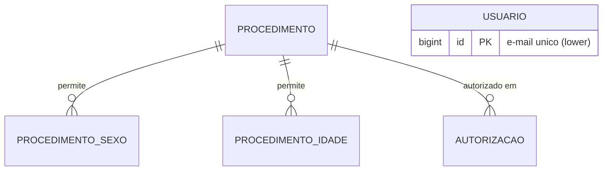

# DATABASE_DESIGN — PostgreSQL 16

Base: DDL da versão original (baseline §2). Princípio: **preservar semântica e dados; endurecer integridade**. Migrations Flyway versionadas e imutáveis depois de aplicadas (`java-persistence-performance`).

## 1. Modelo

### V1 — `V1__schema_base.sql`
| Tabela | Colunas | Restrições |
|---|---|---|
| `procedimento` | `id bigint generated always as identity` PK · `numero_procedimento integer not null` · `criado_em timestamptz not null default now()` | `UNIQUE(numero_procedimento)` · `CHECK(numero_procedimento > 0)` |
| `procedimento_sexo` | `procedimento_id bigint not null` · `sexo char(1) not null` | PK `(procedimento_id, sexo)` · FK → `procedimento` `ON DELETE CASCADE` · `CHECK(sexo in ('M','F'))` |
| `procedimento_idade` | `procedimento_id bigint not null` · `idade smallint not null` | PK `(procedimento_id, idade)` · FK `ON DELETE CASCADE` · `CHECK(idade between 0 and 150)` |
| `autorizacao` | `id bigint generated always as identity` PK · `procedimento_id bigint not null` · `permitido boolean not null` · `criada_em timestamptz default now()` (**nullable**, para linhas importadas sem data) | FK → `procedimento` (**sem** cascade) · índice `ix_autorizacao_procedimento(procedimento_id)` |

Diferenças deliberadas × original: PK composta em `sexos/idades` (evita duplicatas, D7), FK real e `NOT NULL` em `autorizacao`, `sexo` textual `M/F` (original: 1/2), `criada_em`/`criado_em` (novos, técnicos). **Sem** UNIQUE em `autorizacao(procedimento_id)` (RN11, EXEC B15).

### V2 — `V2__auditoria.sql` (RN10)
Tabelas Envers com sufixo `_audit`: `revinfo(rev int identity PK, revtstmp bigint)`, `procedimento_audit`, `autorizacao_audit`, `procedimento_sexo_audit`, `procedimento_idade_audit` (colunas `rev`, `revtype` + espelho das colunas, PK `(rev, ids...)`).
- **Risco:** compatibilidade do `hibernate-envers` com o Hibernate efetivo do Boot 4.1.2 e com Java 25. **SPEC-04 executa um spike** (Testcontainers) e registra o resultado em `DECISIONS.md`.
- **Plano B (se o spike falhar):** auditoria por **gatilhos PostgreSQL** gravando as mesmas `*_audit` (operação, versão, colunas, `now()`), sem mudar API nem domínio.

### V3 — `V3__usuario.sql` (autenticação, SPEC-22)
`usuario(id bigint generated always as identity PK, email varchar(254) not null, senha_hash varchar(100) not null, ativo boolean not null default true, criado_em timestamptz not null default now())`; `CHECK (email = lower(email))`; `UNIQUE INDEX ux_usuario_email_lower ON usuario (lower(email))`. Senha **somente** como hash BCrypt; sem auditoria Envers; sem seed de senha (primeiro usuário por *bootstrap* via variáveis de ambiente).

### V4 — `V4__catalogo_estendido.sql` (NEW-01, SPEC-12)
Colunas em `procedimento`, todas **nullable no banco** (linhas pré-existentes/importadas não têm esses dados): `nome varchar(200)`, `codigo_tuss varchar(30)`, `categoria varchar(30)` (CHECK pela lista), `especialidade varchar(30)`, `tipo_cobertura varchar(20)` (`PLANO|REGRAS|NAO_COBERTO`), `quantidade_maxima integer CHECK(>=1)`, `periodo varchar(10)` (`MES|ANO|VIDA`), `exige_autorizacao_previa boolean`, `exige_justificativa_medica boolean`; `CHECK (quantidade_maxima IS NULL OR periodo IS NOT NULL)`. A **obrigatoriedade** (nome, categoria) é regra da API para novos cadastros, não do banco. Espelho nas `*_audit`.

### Seed — `db/seed/` (somente perfil `local`)
`V1000__seed_local.sql` com `1234 F [10,20]`, `4567 M,F [20,30]`, `6789 M,F [10]` (mesmos dados do `DBServiceTests` original). Perfil `local` adiciona `classpath:db/seed` a `spring.flyway.locations`. **Nunca em produção.**

## 2. Integridade e concorrência
- Duplicidade de `numero_procedimento`: garantida pelo UNIQUE; a aplicação traduz `DataIntegrityViolationException` em `403 PROCEDIMENTO_DUPLICADO` (mantém RN2, remove a corrida).
- Sem endpoints de update/delete de procedimento ⇒ sem bloqueio otimista; nenhuma `version`.
- `autorizacao` só é escrita após leitura do procedimento na mesma transação; `permitido` sempre `true` (RN8) — coluna mantida por fidelidade e para evolução (PEN-01).
- `ddl-auto=none`; esquema só por Flyway; checksum divergente = falha, nunca reparo automático.

## 3. Consultas relevantes e desempenho
| Consulta | Estratégia |
|---|---|
| Lista de procedimentos paginada (+`q` por prefixo do número) | `ORDER BY numero_procedimento`; coleções via `@BatchSize` (não fazer `JOIN FETCH` de duas coleções com paginação) |
| Autorizações recentes | `ORDER BY id DESC` (PK), carregar procedimento em lote |
| Painel | SQL agregado: `count(*)` de procedimento/autorizacao; `select idade, count(*) from procedimento_idade group by idade order by idade`; `select sexo, count(distinct procedimento_id) from procedimento_sexo group by sexo`; últimas 4 autorizações |
Volumes esperados são pequenos (catálogo); índices adicionais só com evidência (`EXPLAIN`) em SPEC-42.

## 4. Compatibilidade e migração de dados
Não há evidência de dados de produção (dev `create-drop`, teste H2 semeado). A importação da versão original é **condicional** (SPEC-50): mapeia `sexos` `1→M`, `2→F` (outros valores são rejeitados e listados), de-duplica `sexos/idades`, preserva `numero_procedimento`, converte `solicitar_procedimento→autorizacao` com `criada_em NULL`. Sem perda de dados: relatório de contagens origem × destino obrigatório.

## 5. Testes de persistência
PostgreSQL 16 real via Testcontainers (nunca H2): migração limpa, UNIQUE, FKs, CHECKs, round-trip do adaptador, auditoria, consultas do painel com dados conhecidos.

## V5 · Faixa etária (2026-11-09)
`procedimento_faixa_etaria (procedimento_id, faixa)` com PK composta, FK em cascata e `check faixa in ('CRIANCA','ADOLESCENTE','ADULTO','IDOSO')`, mais `procedimento_faixa_etaria_audit` (Envers). Os dados de `procedimento_idade` são convertidos pela faixa que contém cada idade (0–12, 13–20, 21–59, 60+) e a tabela é removida; `procedimento_idade_audit` permanece como histórico sem uso. Seed local: 1234 = CRIANCA+ADOLESCENTE, 4567 = ADOLESCENTE+ADULTO, 6789 = CRIANCA.
