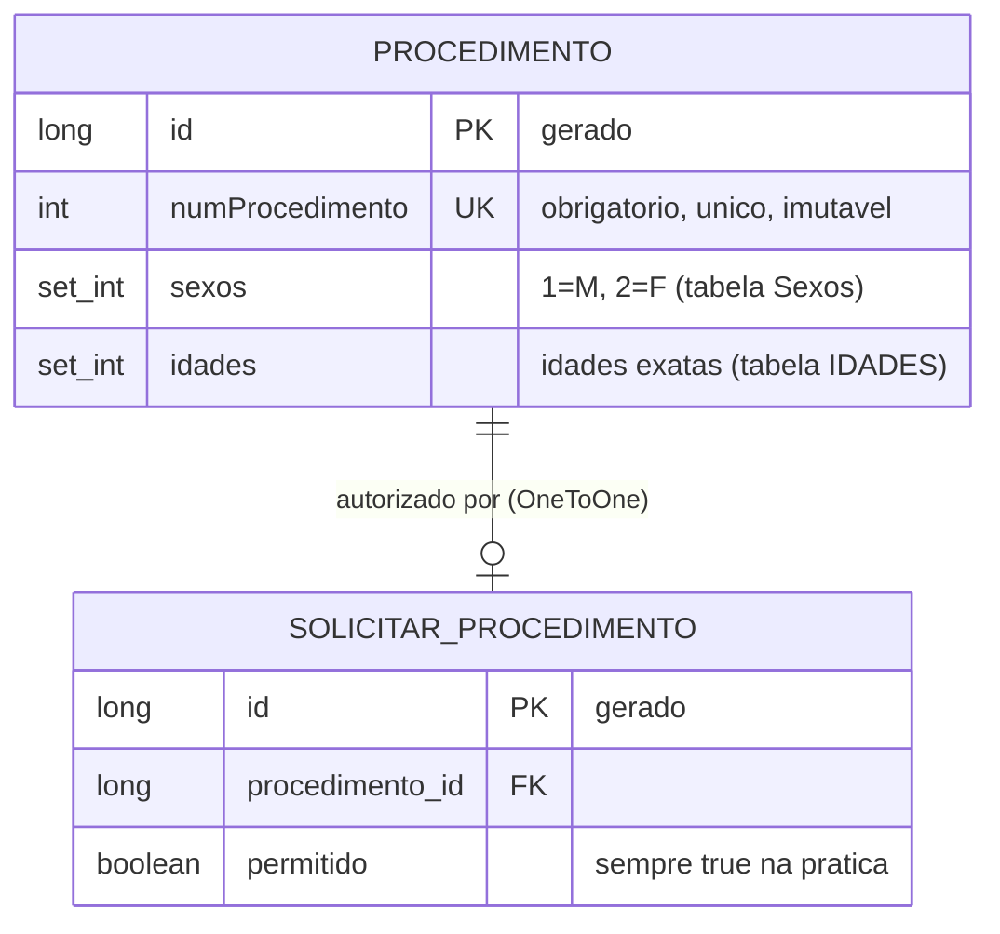
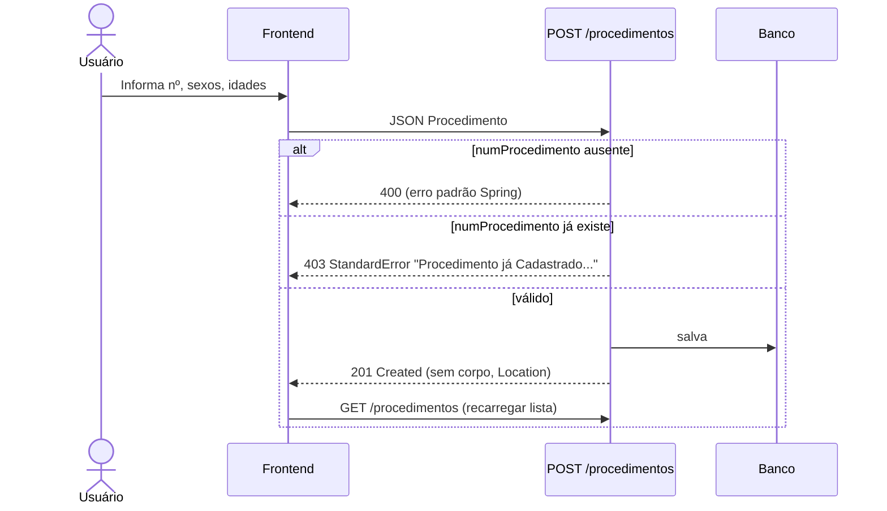
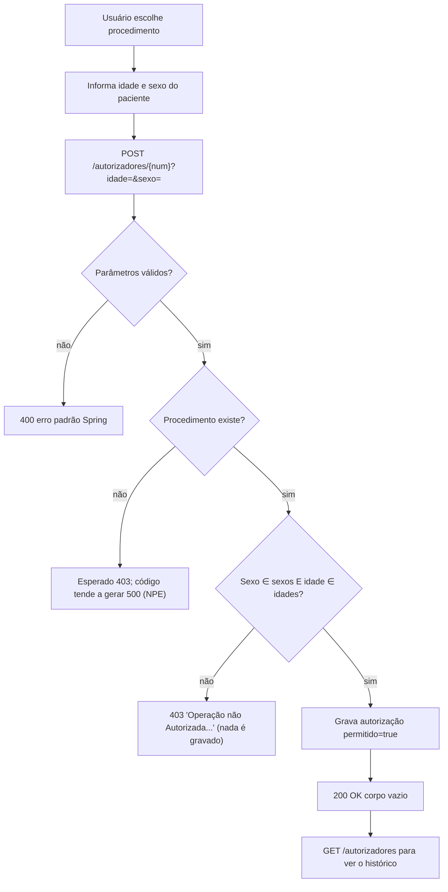
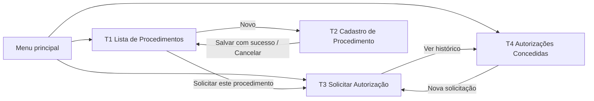

# DESIGN SYSTEM DISCOVERY — API Autorizador de Procedimentos Médicos

> Documento de descoberta funcional para o agente de Product Design / UX-UI.
> Fonte: leitura do código-fonte real do backend (`rest-api-backend-autorizador-processo`). Nenhum código foi alterado ou executado.
>
> **Legenda de confiança usada ao longo do documento**
> - **[CÓDIGO]** — comportamento lido diretamente do código.
> - **[INFERIDO]** — dedução a partir do código/dependências, **não executada** (precisa de validação em runtime).
> - **[SUGESTÃO]** — ideia de UX que **não** existe na API; marcada para não ser confundida com funcionalidade real.

---

## 1. Visão geral da aplicação

**O que é:** uma API REST (Spring Boot 2.2.6, Java 8, WAR) chamada "API – Controle de Procedimentos Médicos" (README: "Autorizador de Processos Médicos").

**Problema que resolve:** manter um catálogo de procedimentos médicos, cada um com os **sexos** e **idades** permitidos, e **autorizar ou negar** a realização de um procedimento para um paciente, conferindo sexo e idade informados contra essas regras.

**Capacidades reais (4)** — coincidem com o README:
1. Cadastrar novo procedimento (com suas regras de sexo e idade).
2. Listar procedimentos cadastrados.
3. Solicitar autorização de um procedimento informando idade e sexo do paciente.
4. Listar autorizações concedidas.

**O que a API NÃO tem [CÓDIGO]:**
- Autenticação/autorização (sem Spring Security no `pom.xml`): **não há login, perfis nem permissões**.
- Editar ou excluir procedimento; buscar procedimento por ID; paginação, filtros ou ordenação.
- Cadastro de pacientes, usuários, médicos, planos ou convênios.
- Configuração de CORS (nenhum `@CrossOrigin`/config) — ver seção 10.

**Infraestrutura relevante para o frontend:**
| Item | Valor |
|---|---|
| Porta/URL base típica | `http://localhost:8080` (README) |
| Documentação Swagger | `/swagger-ui.html` (springfox 2.6.1; expõe só os controllers do pacote `resources`) |
| Perfil ativo por padrão | `test` → H2 em arquivo (`jdbc:h2:file:~/test`), console em `/h2-console`, **com carga de dados de exemplo** |
| Perfil `dev` | MySQL local, `ddl-auto=create-drop` |
| Formato | JSON; sem prefixo de versão (`/v1`) |

---

## 2. Módulos e funcionalidades

| Módulo | Rota base | Objetivo | Funcionalidades existentes |
|---|---|---|---|
| **Procedimentos** (catálogo de regras) | `/procedimentos` | Manter o catálogo de procedimentos e as regras de elegibilidade (sexos e idades permitidos) | Cadastrar; Listar |
| **Autorizadores** (solicitação/histórico) | `/autorizadores` | Avaliar elegibilidade de um paciente a um procedimento e registrar a autorização | Solicitar autorização; Listar autorizações concedidas |
| **Tratamento de erros** (transversal) | — | Respostas de erro padronizadas | Formato `StandardError` para 3 tipos de exceção de negócio |
| **Auditoria** (transversal, sem endpoint) | — | Hibernate Envers audita as duas entidades (`procedimento_audit`, `SolicitarProcedimento_audit`) | Nenhuma exposição via API [CÓDIGO] |

**Perfis de usuário:** o código não define nenhum. [INFERIDO a partir da finalidade do README] existem dois papéis *de uso*, sem qualquer controle de acesso na API:
- **Quem mantém as regras** (cadastra/consulta procedimentos).
- **Quem solicita/consulta autorizações** (operador de atendimento/autorização).
Uma mesma pessoa pode fazer tudo, pois não há distinção técnica.

---

## 3. Catálogo dos endpoints

Todos os endpoints são públicos (sem token/cabeçalho de autenticação). Content-Type de requisição JSON onde há corpo.

### 3.1 `POST /procedimentos` — Cadastrar procedimento
- **Finalidade:** criar um procedimento com suas regras de sexo e idade.
- **Corpo (JSON)** — entidade `Procedimento`:

| Campo | Tipo | Obrigatório | Observação |
|---|---|---|---|
| `numProcedimento` | inteiro | **Sim** (`@NotNull`) | Identificador de negócio; **único** e não atualizável |
| `sexos` | lista de inteiros | Não validado | Valores aceitos na entrada: `1` = Masculino (M), `2` = Feminino (F) [INFERIDO — ver 10.4] |
| `idades` | lista de inteiros | Não validado | Idades **exatas** permitidas (não é faixa) |
| `id` | inteiro | Não | Gerado pelo banco; não deveria ser enviado |

- **Exemplo de requisição**
```http
POST /procedimentos
Content-Type: application/json

{
  "numProcedimento": 9999,
  "sexos": [1, 2],
  "idades": [18, 30, 45]
}
```
- **Resposta de sucesso:** `201 Created`, **sem corpo**; cabeçalho `Location: http://host/procedimentos/{id}` [CÓDIGO]. *Atenção: não existe `GET /procedimentos/{id}`, então esse link não é navegável.*
- **Erros**

| Situação | Status | Corpo |
|---|---|---|
| `numProcedimento` ausente/nulo | `400` | Formato **padrão do Spring** (não o `StandardError`), pois não há handler para `@Valid` [INFERIDO] — contém a mensagem "informe o número do procedimento para prosseguir com a operação." |
| `numProcedimento` já cadastrado | `403` | `StandardError`, `error="Não Autorizado"`, `message="Procedimento já Cadastrado na Base de Dados : Nº 9999"` |
| JSON malformado / tipo inválido | `400` | Padrão do Spring [INFERIDO] |
| Código de sexo diferente de 1 ou 2 | `400` ao ler/serializar (`IllegalArgumentException` customizada: "Código inválido :N") [INFERIDO — ver 10.4] |

### 3.2 `GET /procedimentos` — Listar procedimentos
- **Parâmetros:** nenhum. Sem paginação, filtro ou ordenação definida.
- **Resposta:** `200 OK`, array de procedimentos. Na **saída** `sexos` vem como **nomes do enum** (`"M"`, `"F"`) [INFERIDO: o getter público `getSexos()` devolve `Set<Sexo>`].
```json
[
  { "id": 1, "numProcedimento": 1234, "sexos": ["F"],      "idades": [10, 20] },
  { "id": 2, "numProcedimento": 4567, "sexos": ["M", "F"], "idades": [20, 30] },
  { "id": 3, "numProcedimento": 6789, "sexos": ["M", "F"], "idades": [10] }
]
```
- Ordem dos elementos de `sexos`/`idades` não é garantida (são `Set`).
- Lista vazia → `200` com `[]`.

### 3.3 `POST /autorizadores/{numProcedimento}?idade={n}&sexo={M|F}` — Solicitar autorização
- **Finalidade:** verificar se o paciente (idade + sexo) é elegível ao procedimento; se sim, **registra** a autorização.
- **Parâmetros**

| Parâmetro | Local | Tipo | Obrigatório | Observação |
|---|---|---|---|---|
| `numProcedimento` | path | inteiro | Sim | É o **número do procedimento** (`numProcedimento`), **não** o `id` |
| `idade` | query | inteiro | Sim | Comparação por igualdade exata com a lista `idades` |
| `sexo` | query | texto | Sim | Comparado ao **nome** do enum (`M` ou `F`), sem diferenciar maiúsculas/minúsculas |

- **Sem corpo de requisição.**
- **Exemplo (autorizado)**
```http
POST /autorizadores/4567?idade=20&sexo=F
```
→ `200 OK`, **corpo vazio**. [CÓDIGO] A resposta não devolve o registro criado nem o ID.
- **Exemplo (negado)**
```http
POST /autorizadores/1234?idade=30&sexo=M
```
→ `403 Forbidden`
```json
{
  "timestamp": 1730000000000,
  "status": 403,
  "error": "Não Autorizado",
  "message": "Operação não Autorizada, Sexo e/ou Idade não aderentes ao Procedimento Solicitado.",
  "path": "/autorizadores/1234"
}
```
- **Erros**

| Situação | Status | Observação |
|---|---|---|
| Sexo **e/ou** idade fora das regras | `403` | Mensagem acima. A API não informa *qual* dos dois falhou |
| `idade` ou `sexo` ausentes | `400` | Padrão do Spring (parâmetro obrigatório) [INFERIDO] |
| `idade` não numérica / `numProcedimento` não numérico | `400` | Padrão do Spring [INFERIDO] |
| `numProcedimento` **não cadastrado** | **Esperado 403, mas o código provavelmente retorna `500`** | O ramo de erro chama `result.getNumProcedimento()` com `result == null` → `NullPointerException` [CÓDIGO; efeito HTTP INFERIDO]. Ver 10.1 |
| Autorizar de novo o mesmo procedimento | Possível `500` por violação de unicidade | `@OneToOne` com Procedimento tende a gerar restrição única [INFERIDO]. Ver 10.2 |

### 3.4 `GET /autorizadores` — Listar autorizações concedidas
- **Parâmetros:** nenhum. Sem paginação/filtro.
- **Resposta:** `200 OK`, array de `SolicitarProcedimento`:
```json
[
  {
    "id": 1,
    "procedimento": { "id": 2, "numProcedimento": 4567, "sexos": ["M","F"], "idades": [20,30] },
    "permitido": true
  }
]
```
- Lista vazia → `200` com `[]`.
- **Limitação importante [CÓDIGO]:** a autorização guardada contém **apenas** o procedimento e `permitido`. **Idade e sexo do paciente, data/hora e solicitante não são persistidos.**

### 3.5 Formato de erro padrão (`StandardError`)
```json
{ "timestamp": 1730000000000, "status": 403, "error": "Não Autorizado", "message": "...", "path": "/rota" }
```
`timestamp` é epoch em **milissegundos** (número, não data ISO).

| Exceção | HTTP | `error` | Uso real hoje |
|---|---|---|---|
| `RequestNotAutorizationExecption` | 403 | "Não Autorizado" | Procedimento duplicado; autorização negada |
| `IllegalArgumentException` (customizada) | 400 | "Falha na Integridades dos Dados" | Código de sexo inválido |
| `ObjectNotFoundExecption` | 404 | "Não encontrado" | **Declarada, mas nenhum serviço a lança** |

### 3.6 Relacionamento entre endpoints
- `POST /procedimentos` alimenta `GET /procedimentos` e é **pré-requisito** de `POST /autorizadores/{n}` (o procedimento precisa existir).
- `POST /autorizadores/{n}` alimenta `GET /autorizadores`.
- `GET /procedimentos` é a única fonte para saber **quais `numProcedimento`, sexos e idades** existem — útil para montar a tela de solicitação.
- Não há ligação por `id` exposta entre os módulos além de `procedimento` aninhado em `GET /autorizadores`.

---

## 4. Regras de negócio relevantes

| # | Regra | Origem |
|---|---|---|
| RN1 | `numProcedimento` é obrigatório no cadastro | `@NotNull` em `Procedimento` |
| RN2 | `numProcedimento` é **único**; tentar cadastrar duplicado → 403 | `unique=true` + checagem em `ProcedimentoServiceImpl.save` |
| RN3 | `numProcedimento` não pode ser alterado após criado | `updatable=false` (e não existe endpoint de edição) |
| RN4 | Cada procedimento define um **conjunto de sexos** permitidos (M e/ou F) e um **conjunto de idades exatas** permitidas | Entidade `Procedimento` |
| RN5 | Autorização exige **sexo E idade** aderentes (ambos); basta um falhar para negar | `SolicitarProcedimentoService.save` |
| RN6 | Idade é comparada por **igualdade exata** com os valores cadastrados (ex.: `[18,30]` não autoriza 19 nem 25). **Não há faixas** | idem |
| RN7 | Sexo da solicitação é comparado ao nome do enum (`M`/`F`), ignorando caixa. Outros valores (ex.: "Masculino") **nunca** casam e resultam em negação | idem |
| RN8 | Somente autorizações **concedidas** são gravadas (`permitido` é sempre `true`). Negativas **não deixam registro** | idem |
| RN9 | Procedimento sem sexos ou sem idades cadastrados nunca autoriza ninguém (não há validação que impeça o cadastro assim) | consequência de RN5 e ausência de validação |
| RN10 | Alterações nas duas entidades são auditadas (Envers), sem acesso via API | `@Audited` |

**Códigos de sexo:** `1` = M (Masculino), `2` = F (Feminino) — única enumeração do sistema.

**Dados de exemplo (perfil `test`, carregados na inicialização):**

| numProcedimento | Sexos | Idades |
|---|---|---|
| 1234 | F | 10, 20 |
| 4567 | M, F | 20, 30 |
| 6789 | M, F | 10 |

---

## 5. Entidades e relacionamentos



- `Procedimento` 1—0..1 `SolicitarProcedimento` (declarado `@OneToOne` unidirecional a partir da autorização).
  Semanticamente seria de se esperar vários pedidos por procedimento; o mapeamento diz o contrário (ver 10.2).
- **Operações por recurso**

| Recurso | Criar | Listar | Buscar por ID | Editar | Excluir |
|---|---|---|---|---|---|
| Procedimento | ✅ | ✅ | ❌ | ❌ | ❌ |
| Autorização (SolicitarProcedimento) | ✅ (via `POST /autorizadores/{n}`) | ✅ | ❌ | ❌ | ❌ |

---

## 6. Fluxos operacionais

### 6.1 Cadastrar procedimento

- **Informações necessárias:** `numProcedimento` (obrigatório); `sexos` e `idades` (opcionais tecnicamente, necessários na prática — RN9).
- **Resultado:** o `201` não devolve o objeto criado; o frontend precisa reconsultar `GET /procedimentos` para exibi-lo.

### 6.2 Solicitar autorização (fluxo central)

- **Caminho feliz:** 200 vazio → a UI deve comunicar "Autorizado" por conta própria (não há corpo para exibir).
- **Caminho negado:** 403 com mensagem; a API não diz se foi sexo ou idade.
- **Alternativas/erros:** 400 (parâmetros), 403, e os possíveis 500 descritos em 10.1 e 10.2.

### 6.3 Consultar catálogo
`GET /procedimentos` → `200` + lista (ou `[]`). Sem filtros: qualquer busca/ordenação teria de ser feita no cliente [SUGESTÃO].

### 6.4 Consultar autorizações
`GET /autorizadores` → `200` + lista (ou `[]`). Cada item mostra o procedimento (com regras) e `permitido`.

---

## 7. Inventário de telas

> Telas derivadas apenas do comportamento real da API. Itens marcados [SUGESTÃO] são apoio de UX, não funcionalidade do backend.

### T1. Lista de Procedimentos
- **Finalidade:** consultar o catálogo e as regras de cada procedimento.
- **Informações:** `numProcedimento`, sexos permitidos (M/F → Masculino/Feminino), idades permitidas, `id` (secundário).
- **Ações:** abrir "Novo procedimento" (T2); iniciar "Solicitar autorização" já com o procedimento selecionado (T3) [SUGESTÃO de atalho].
- **Endpoints:** `GET /procedimentos`.
- **Navega para:** T2, T3.
- **Estados:** *carregando*; *sucesso* (tabela/cartões); *vazio* (`[]` → convidar ao primeiro cadastro); *erro* (falha de rede/servidor); busca/ordenação só no cliente [SUGESTÃO].

### T2. Cadastro de Procedimento
- **Finalidade:** criar um procedimento e suas regras.
- **Campos:** `numProcedimento` (obrigatório, inteiro), sexos (M, F — seleção múltipla; enviar como 1/2), idades (lista de inteiros).
- **Ações:** Salvar; Cancelar.
- **Endpoints:** `POST /procedimentos`; depois `GET /procedimentos`.
- **Navega para:** T1 após sucesso.
- **Estados:** *inicial*; *enviando*; *sucesso* (201 → mensagem e volta à lista); *erro 403 duplicado* (mostrar `message` junto ao campo número); *erro 400* (campo obrigatório); *erro de rede/500*.
- **Observação:** como sexos/idades não são validados pela API, a UI decidirá se exige ao menos um de cada (RN9) — decisão de produto, não regra do backend.

### T3. Solicitar Autorização
- **Finalidade:** testar elegibilidade e registrar autorização.
- **Campos:** procedimento (`numProcedimento`), idade do paciente (inteiro), sexo (M/F).
- **Ações:** Solicitar autorização; Limpar.
- **Endpoints:** `POST /autorizadores/{numProcedimento}?idade&sexo`; `GET /procedimentos` para popular o seletor de procedimento [SUGESTÃO de uso].
- **Navega para:** T4 (ver histórico).
- **Estados:** *inicial*; *enviando*; *autorizado* (200 vazio → "Autorizado"); *negado* (403 → mostrar `message`); *erro de validação* (400); *erro inesperado* (500 — inclui procedimento inexistente e repetição, ver 10.1/10.2); *sem procedimentos cadastrados* (seletor vazio).
- **Dado que a UI não pode mostrar:** motivo específico da negativa (sexo vs. idade) — a API não informa.

### T4. Autorizações Concedidas
- **Finalidade:** histórico das autorizações aprovadas.
- **Informações:** nº do procedimento, regras do procedimento, `permitido`, `id` da autorização. **Não há** data, paciente, idade, sexo ou usuário.
- **Ações:** apenas consulta (sem editar/excluir/detalhar).
- **Endpoints:** `GET /autorizadores`.
- **Navega para:** T3 (nova solicitação), T1.
- **Estados:** *carregando*; *sucesso*; *vazio*; *erro*.

### (Opcional) Shell de navegação / Início
Apenas contêiner de navegação (menu para T1–T4). **Não existe endpoint de dashboard/estatísticas**; qualquer contagem seria derivada no cliente a partir dos dois `GET` [SUGESTÃO].

---

## 8. Mapa de navegação



Sem autenticação na API, **não há tela de login nem rotas protegidas** no escopo atual.

---

## 9. Relacionamento entre telas e endpoints

| Tela | `GET /procedimentos` | `POST /procedimentos` | `POST /autorizadores/{n}` | `GET /autorizadores` |
|---|:-:|:-:|:-:|:-:|
| T1 Lista de Procedimentos | ✅ | | | |
| T2 Cadastro de Procedimento | ✅ (recarregar) | ✅ | | |
| T3 Solicitar Autorização | ✅ (popular seletor) | | ✅ | |
| T4 Autorizações Concedidas | | | | ✅ |

**Mapa de resposta → comportamento de UI**

| Resposta | Onde ocorre | Mensagem/ação de UI sugerida pelo contrato |
|---|---|---|
| 201 | T2 | Sucesso; voltar à lista |
| 200 (vazio) | T3 | "Autorizado" |
| 403 `Procedimento já Cadastrado...` | T2 | Erro no campo número |
| 403 `Operação não Autorizada...` | T3 | Resultado "Negado" (não é falha técnica) |
| 400 | T2/T3 | Erro de validação |
| 5xx / rede | todas | Erro genérico + tentar novamente |

> Atenção de UX: o **403 é usado para duas situações distintas** (duplicidade no cadastro e negativa de autorização). Na T3 o 403 é um *resultado de negócio esperado*, não um erro de permissão.

---

## 10. Observações, limitações e dúvidas identificadas

### 10.1 Procedimento inexistente na autorização [CÓDIGO]
Em `SolicitarProcedimentoService.save`, quando o procedimento não é encontrado o código monta a mensagem de erro usando `result.getNumProcedimento()` com `result == null`. Isso lança `NullPointerException` antes de montar a exceção de negócio, e não há handler para ela → o cliente tende a receber **500** com corpo padrão do Spring, em vez do 403/404 com `StandardError`. *Efeito HTTP exato não executado.* Também existe um handler de 404 (`ObjectNotFoundExecption`) que ninguém usa.

### 10.2 Cardinalidade da autorização [INFERIDO]
`SolicitarProcedimento.procedimento` é `@OneToOne`. Com geração de schema do Hibernate, isso costuma criar restrição única na FK, o que impediria **mais de uma autorização para o mesmo procedimento** (segunda tentativa → erro de banco/500). Não foi confirmado em execução. **Dúvida de produto:** o histórico deveria permitir várias autorizações do mesmo procedimento (para pacientes diferentes)? O modelo atual de dados sugere que não é suportado.

### 10.3 Dados do paciente e auditoria de uso
Idade/sexo do paciente, data/hora e solicitante **não são gravados**; autorizações negadas **não são registradas**. A tela de histórico (T4) fica limitada ao que existe. Qualquer coluna a mais (data, paciente, motivo) exigiria mudança de backend — fora do escopo desta descoberta.

### 10.4 Assimetria de `sexos` entrada/saída [INFERIDO]
Internamente `sexos` é `Set<Integer>`, mas o getter público devolve `Set<Sexo>`. A serialização (saída) usa o getter → `["M","F"]`; a desserialização (entrada) tende a usar o setter gerado pelo Lombok → aceita `[1,2]`. Se isso se confirmar, **o formato que se lê não é o que se envia**. Precisa ser validado chamando a API (Swagger/Postman) antes de fixar contratos de formulário. Se o frontend enviar `["M","F"]`, possivelmente será rejeitado (400).

### 10.5 Outras observações
- **Sem CORS configurado:** um frontend em origem diferente (ex.: `localhost:4200`) provavelmente será bloqueado pelo navegador sem ajuste no backend [INFERIDO].
- **Sem validação de conteúdo:** idade negativa/absurda, listas vazias e `numProcedimento` ≤ 0 são aceitos no cadastro.
- **Mensagens de erro** contêm erros de grafia vindos do backend ("ná Cadastrado", "Integridades", "Nº") — a UI deve decidir se exibe literalmente ou mapeia por status/regra.
- **`id` no corpo do POST:** se enviado, o `save` do JPA pode tratar como atualização/merge de registro existente [INFERIDO, não testado]. A UI não deve enviar `id`.
- **Segurança:** credenciais do MySQL aparecem em `application-dev.properties` (versionadas). Não afeta o design da interface, mas é relevante para o time.
- **Swagger** documenta somente os controllers; não há descrições/exemplos anotados.
- **Sem versionamento, paginação, ordenação ou filtros**: listas grandes terão de ser tratadas no cliente.

### 10.6 Perguntas em aberto para Produto/Negócio
1. Quem são os perfis reais (administrador de regras × operador) e haverá login futuramente?
2. Idades devem ser **faixas** (ex.: 18–65) em vez de valores exatos? Hoje só valores exatos funcionam.
3. Procedimentos precisam de **nome/descrição**? Hoje só existe o número.
4. Autorizações negadas devem ser registradas e exibidas?
5. Será necessário editar/excluir procedimentos? Hoje não é possível.
6. A autorização é por paciente (ver 10.2/10.3) ou apenas uma "validação de regra"?

### 10.7 Funcionalidades existentes × necessidades não implementadas
| Existe hoje | Não existe (não inventar na UI como se existisse) |
|---|---|
| Cadastrar/listar procedimentos | Editar, excluir, buscar por ID, filtrar, paginar |
| Solicitar autorização por idade+sexo | Motivo detalhado da negativa, registro de negativas, dados do paciente |
| Listar autorizações concedidas | Data/hora, solicitante, detalhe, cancelamento |
| Mensagens de erro em `StandardError` | Login, perfis, permissões |
