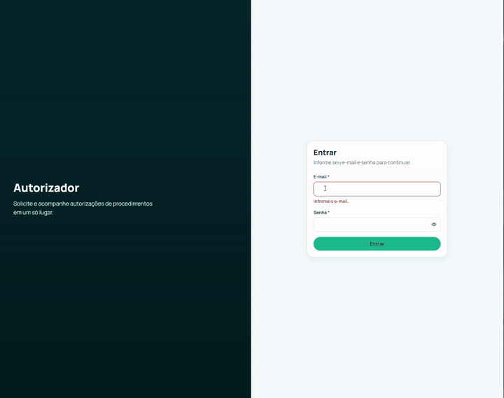

<div align="center">

# 🏥 Autorizador de Procedimentos Médicos

**Cadastre procedimentos, informe o paciente e receba a decisão na hora: a autorização depende do sexo e da faixa etária.**

Uma API Spring Boot e um app Angular, com contrato OpenAPI primeiro, login JWT, arquitetura verificada por testes e entrega guiada por especificações (Spec-Driven Development) com Claude Code.

[](https://github.com/dowglasmaia/rest-api-backend-autorizador-processo/actions/workflows/backend-ci.yml)
[](https://github.com/dowglasmaia/rest-api-backend-autorizador-processo/actions/workflows/frontend-ci.yml)
[](https://github.com/dowglasmaia/rest-api-backend-autorizador-processo/actions/workflows/integracao-ci.yml)


<br />



<sub>Demonstração de 30 s (vídeo acelerado): cadastro de procedimento, solicitação de autorização e painel.</sub>

</div>

> **Produto de demonstração.** Projeto de portfólio: todos os nomes, procedimentos e pacientes são fictícios, e nenhum dado real é usado.

---

## 📑 Sumário

1. [O que é este projeto?](#-o-que-é-este-projeto)
2. [O produto e suas regras de negócio](#-o-produto-e-suas-regras-de-negócio)
3. [Arquitetura](#-arquitetura)
4. [Stack tecnológica](#-stack-tecnológica)
5. [Como foi construído: SDD + Claude Code](#-como-foi-construído-sdd--claude-code)
6. [Qualidade e provas](#-qualidade-e-provas)
7. [Estrutura do repositório](#-estrutura-do-repositório)
8. [Como executar](#-como-executar)
9. [Contrato OpenAPI e CI](#-contrato-openapi-e-ci)
10. [Massa de teste e fluxo de ponta a ponta](#massa-de-teste-e-fluxo-de-ponta-a-ponta)
11. [Segurança](#segurança)
12. [Versão original e especificações](#-versão-original-e-especificações)
13. [Sobre o desenvolvedor](#-sobre-o-desenvolvedor)

---

## 🎯 O que é este projeto?

O Autorizador é o tipo de sistema que uma operadora de saúde usa no dia a dia: o analista cadastra os **procedimentos** (consultas, exames, cirurgias, terapias), diz **quem pode fazê-los** (sexo e faixa etária) e, quando chega um pedido, informa o procedimento, a idade e o sexo do paciente para receber a **decisão de autorização**, com histórico e um painel de indicadores.

Ele existe por dois motivos:

| | |
|---|---|
| **Negócio** | Mostrar como uma regra de elegibilidade pode ser simples de explicar e difícil de burlar: quem decide é o servidor, uma negativa nunca grava nada e todo acesso exige login. |
| **Engenharia** | Mostrar a modernização de uma API antiga (Spring Boot 2.2 com H2) para uma plataforma atual, trabalhando com IA como colega: o responsável decide, a especificação define o "pronto" e o agente implementa com testes, passo a passo. |

É um **monorepo** com duas aplicações que evoluem juntas:

| Parte | O que é | Pasta |
|---|---|---|
| ☕ **Backend** | API REST Spring Boot: fonte única da verdade das regras | [`api-autorizador-processo`](api-autorizador-processo) |
| 🅰️ **Frontend** | App web Angular responsivo e acessível, com tipos gerados do contrato | [`app-autorizador-processo`](app-autorizador-processo) |
| 📐 **Specs** | Base de conhecimento SDD: memória, 31 specs, relatórios e design | [`.specs`](.specs/INDEX.md) |

---

## 💼 O produto e suas regras de negócio

### O que o usuário faz

| Capacidade | O que acontece | Endpoint (`/api/v1`) |
|---|---|---|
| **Entrar** | Login por e-mail e senha; a API devolve um JWT de 60 minutos | `POST /auth/login` |
| **Cadastrar procedimento** | Assistente em 4 etapas: identificação, cobertura, elegibilidade (sexos e faixas etárias) e utilização | `POST /procedimentos` |
| **Consultar procedimentos** | Lista paginada, com busca pelo número e ordenação | `GET /procedimentos`, `GET /procedimentos/{id}` |
| **Solicitar autorização** | Informa procedimento, idade e sexo; recebe autorizado ou negado | `POST /autorizacoes` |
| **Ver autorizações** | Histórico das concedidas, mais recentes primeiro | `GET /autorizacoes` |
| **Acompanhar o painel** | Totais, cobertura por faixa etária, distribuição por sexo e últimas autorizações | `GET /painel/resumo` |

### Regras que o sistema nunca quebra

Cada regra está escrita nas specs e protegida por testes.

- 🎂 **A idade é decidida por faixa, não por número.** `CRIANCA` (0 a 12 anos), `ADOLESCENTE` (13 a 20, isto é, de 12 anos e 1 dia até 20), `ADULTO` (21 a 59) e `IDOSO` (60 a 150). O procedimento guarda as faixas aceitas e a solicitação envia a idade em anos completos do paciente.
- ✅ **Autoriza somente com sexo E faixa aceitos.** Procedimento sem sexos ou sem faixas nunca autoriza.
- 🚫 **Negativa não grava nada.** Só autorizações concedidas existem no histórico; várias autorizações para o mesmo procedimento são permitidas.
- 🔢 **O número do procedimento é único e imutável.** Cadastrar um número já existente responde `403 PROCEDIMENTO_DUPLICADO`; não há atualização.
- 🧾 **Erros previsíveis.** Respostas no padrão RFC 9457 (`application/problem+json`) com `code` estável; negativas de negócio usam `403` e trazem o `code` (veja [a tabela](#por-que-apareceu-403-e-o-que-ele-quer-dizer)).
- 🕵️ **Auditoria.** Alterações nos procedimentos ficam registradas pelo Hibernate Envers.
- 🔒 **Tudo exige login**, exceto `POST /auth/login` e o health check.
- 🙈 **Privacidade.** Idade e sexo do paciente não são gravados nem aparecem em log.

> Contrato completo de comportamento: [`.specs/memory/produto.md`](.specs/memory/produto.md).

---

## 🧱 Arquitetura

```
        Navegador                       Nginx (contêiner app)             API Spring Boot (contêiner api)
  ┌──────────────────┐  HTTP    ┌───────────────────────────┐        ┌───────────────────────────────────┐
  │ Angular 21       │─────────►│ serve a SPA               │ /api/  │  api ─► application ─► domain     │
  │ Signals, zoneless│          │ proxy /api/ (mesma origem)│───────►│ (REST)  (casos de uso) (Java puro)│
  │ Tailwind 4       │          │ headers de segurança      │        │            ▲                      │
  └──────────────────┘          └───────────────────────────┘        │            └─ infrastructure      │
        Bearer JWT                                                    └───────────────┬───────────────────┘
                                                                                      │ JPA + Flyway
                                                                              ┌───────▼────────┐
                                                                              │ PostgreSQL 16  │
                                                                              └────────────────┘
```

### Backend: "Hexagonal Pragmática"

A API é organizada **por funcionalidade**, com dependências apontando para dentro e um domínio que não conhece framework:

```
org.maia.autorizador
├── autenticacao/   api · application · domain · infrastructure   (JWT, BCrypt, limite de tentativas)
├── procedimento/   api · application (port, usecase) · domain · infrastructure
├── autorizacao/    api · application (port, usecase) · domain · infrastructure
├── painel/         api · application · infrastructure            (consultas agregadas, só leitura)
└── shared/         error · security · web · persistence          (mantido mínimo)
```

- **Uma classe de caso de uso por operação** (`CadastrarProcedimentoUseCase`, `SolicitarAutorizacaoUseCase`, …).
- **Portas só para saídas** (repositórios), com adaptadores JPA em `infrastructure`.
- **Imposto, não torcido:** o `ArchitectureTest` (ArchUnit, 23 regras) roda em todo build, e o Spring Modulith verifica os módulos.
- **Contrato primeiro:** o OpenAPI 3.1 é a fonte; interfaces e modelos do backend e os tipos do frontend são **gerados** dele.
- **Banco versionado:** Flyway (V1 esquema, V2 auditoria, V3 usuário, V4 catálogo, V5 faixas etárias), sempre com PostgreSQL real nos testes (Testcontainers, sem H2).

### Frontend

Angular 21 com componentes standalone, **zoneless**, Signals e formulários reativos tipados. Design system próprio (Tailwind com tokens do protótipo), estados de carregamento com skeleton e barra de navegação, movimento que respeita `prefers-reduced-motion` e auditoria de acessibilidade nos testes.

---

## ⚡ Stack tecnológica

### ☕ Backend


[](https://spring.io/projects/spring-boot)
[](https://spring.io/projects/spring-security)
[](https://spring.io/projects/spring-data-jpa)
[](https://spring.io/projects/spring-modulith)
[](https://maven.apache.org/)
[](https://www.openapis.org/)

### 🗄️ Dados e segurança

[](https://www.postgresql.org/)
[](https://flywaydb.org/)
[](https://hibernate.org/orm/envers/)
[](https://jwt.io/)

### 🅰️ Frontend

[](https://angular.dev/)
[](https://www.typescriptlang.org/)
[](https://rxjs.dev/)
[](https://tailwindcss.com/)
[](https://nginx.org/)

### 🧪 Qualidade

[](https://junit.org/junit5/)
[](https://testcontainers.com/)
[](https://www.archunit.org/)
[](https://vitest.dev/)
[](https://playwright.dev/)

### 🚢 Entrega

[](https://www.docker.com/)
[](https://github.com/features/actions)

### 🤖 Fluxo com IA

[](https://claude.com/claude-code)


---

## 🤖 Como foi construído: SDD + Claude Code

> **Nada é implementado sem uma spec aprovada. Nada está "pronto" sem evidência.**

O responsável decide o *quê* e o *porquê*. O Claude Code escreve o código sempre dentro de uma especificação, com testes, e para onde a decisão é humana.

```
   ┌─────────────┐  aprova   ┌─────────────┐  testes antes  ┌───────────────┐
   │ 1. SPEC     │──────────►│ 2. PLANO    │───────────────►│ 3. IMPLEMENTA │
   │ objetivo,   │           │ ondas e     │  (vê falhar,   │ menor passo   │
   │ escopo, DoD │           │ dependências│   depois passa)│               │
   └──────▲──────┘           └─────────────┘                └──────┬────────┘
          │                                                        │
   ┌──────┴───────┐   gates G1–G8        ┌─────────────┐    ┌──────▼───────┐
   │ 6. MEMÓRIA   │◄─────────────────────│ 5. REVISÃO  │◄───│ 4. EVIDÊNCIA │
   │ em sincronia │                      │ humana      │    │ só com prova │
   └──────────────┘                      └─────────────┘    └──────────────┘
```

### Os blocos

| Bloco | O que é | Onde |
|---|---|---|
| 📐 **Specs** | 31 specs: objetivo, escopo, tarefas, critérios de aceite e validação mínima | [`.specs`](.specs/INDEX.md) |
| 🧠 **Memória** | O que o agente lê primeiro: produto e contexto técnico | [`.specs/memory`](.specs/memory) |
| 🧰 **Skills** | Pacotes de especialidade carregados sob demanda | `~/.claude/skills` |
| 🔍 **Gates e revisões** | Aprovações humanas, CI por projeto e verificação de arquitetura | [`.specs/shared/como-executar.md`](.specs/shared/como-executar.md) |

### Skills usadas

| Skill | Uso |
|---|---|
| `java-spring-scaffold` · `java-spring-create-module` | Gerar o backend e criar módulos no modelo hexagonal |
| `openapi-rest-contract` | Contrato primeiro: **prévia → aprovação → geração** |
| `java-modern-engineering` · `java-persistence-performance` | Java 25, JPA, SQL, transações e Flyway |
| `angular-frontend-scaffold` · `angular-module-scaffold` | Projeto Angular e telas a partir das operações aprovadas |
| `angular-tailwind-ui-specialist` · `ui-ux-pro-max` | Interface responsiva e acessível, com tokens de design |
| `animation-best-practices` · `design-motion-design` | Estados de carregamento e transições |

### Decisões humanas que moldaram o projeto

- Nada de "legado" no código: a versão antiga existe só na tag `v0-original`.
- Backend e frontend com **Dockerfile e CI independentes** (só roda o que mudou).
- Java 25 e Spring Boot 4.1.2; login com JWT; ArchUnit validando a arquitetura.
- A regra de idade virou **faixa etária** (ADR-19), porque uma lista de idades exatas não representa a regra de negócio.
- Os dados do "Cadastrar procedimento" do protótipo viraram funcionalidade real do backend.

---

## ✅ Qualidade e provas

| Verificação | Resultado | Onde roda |
|---|---|---|
| Testes do backend (unitários + integração com PostgreSQL real) | **269 testes, 0 falhas** | `./mvnw verify` / Backend CI |
| Regras de arquitetura (ArchUnit) e módulos (Modulith) | **23 regras, 0 violações** | todo build |
| Testes do frontend (Vitest, inclui auditoria de acessibilidade) | **221 testes**, lint limpo, build ok | `npm test` / Frontend CI |
| Testes de ponta a ponta (Playwright, desktop e móvel) | 30 cenários (última execução completa foi antes da regra de faixas) | `npm run e2e` / Integração CI |
| Contrato OpenAPI | Tipos em dia e compatível com o instantâneo base | `check-contract*.mjs` |
| Paridade com a versão original | Casos dourados reexecutáveis ([relatório](.specs/workflows/ferramentas/parity/RELATORIO.md)); a faixa etária é a divergência DIV-09 | `replay.mjs` |
| Segurança e desempenho | Sondagens ativas e smoke de carga ([segurança](.specs/05-quality/SECURITY_REQUIREMENTS.md), [desempenho](.specs/05-quality/PERFORMANCE_REPORT.md)) | `.specs/workflows/ferramentas/` |

Os números foram medidos durante as specs; cada uma tem sua evidência em [`RELATORIO_FINAL.md`](.specs/05-quality/RELATORIO_FINAL.md).

---

## 📂 Estrutura do repositório

```text
.
├─ api-autorizador-processo/      backend Spring Boot 4 · Java 25 · Maven · Dockerfile próprio
├─ app-autorizador-processo/      frontend Angular 21 · Tailwind · Nginx · Dockerfile próprio
├─ docs/                          demo.gif usado neste README
├─ .specs/                        specs, memória, relatórios, design e ferramentas
│  └─ workflows/ferramentas/      parity · contract · perf · security
├─ .github/workflows/             CI independente: backend, frontend e integração
├─ compose.yaml · .env.example    integração local (só o .env.example é versionado)
└─ README.md                      este arquivo
```

| Pasta | O quê | CI |
|---|---|---|
| `api-autorizador-processo/` | API (procedimentos, autorizações, painel, login) | `backend-ci.yml` |
| `app-autorizador-processo/` | App Angular | `frontend-ci.yml` |
| `compose.yaml` | PostgreSQL + API + frontend (Nginx) | `integracao-ci.yml` |

Mais detalhes: [README da API](api-autorizador-processo/README.md) · [README do app](app-autorizador-processo/README.md).

---

## 🚀 Como executar

### Pré-requisitos

| Ferramenta | Versão | Uso |
|---|---|---|
| JDK | 25 (`JAVA_HOME`) | backend |
| Node.js / npm | 24 (mínimo 20.19) | frontend, checagens de contrato e ferramentas |
| Docker com Compose | 29+ | Compose, Testcontainers, e2e, paridade e desempenho |

### Com Docker Compose (tudo de uma vez)

```bash
cp .env.example .env              # valores de desenvolvimento; JWT_SECRET é obrigatório
docker compose up -d --build      # banco + API + frontend: http://localhost:4200
docker compose ps                 # os 3 serviços ficam "healthy" em até ~90 s
docker compose down               # para tudo; o volume postgres-data é preservado
docker compose down -v            # também apaga os dados do banco
```

| Serviço | Porta padrão | Variável |
|---|---|---|
| PostgreSQL | 5432 | `POSTGRES_PORT` |
| API | 8080 | `API_PORT` |
| Frontend (`app`) | 4200 | `APP_PORT` (porta 8080 do contêiner) |

Para criar o primeiro usuário, preencha `AUTH_BOOTSTRAP_EMAIL` e `AUTH_BOOTSTRAP_SENHA` no `.env` (ele é criado só com a tabela de usuários vazia). Sem `JWT_SECRET` (mínimo de 32 bytes) a API não sobe.

O Nginx serve a SPA com fallback para `index.html`, repassa `/api/` para a API (mesma origem, sem CORS), expõe `/healthz` e somente `/actuator/health` do actuator. Detalhes em [`app-autorizador-processo/README.md`](app-autorizador-processo/README.md#contêiner-nginx).

### Só o banco, rodando API e app pelo terminal

```bash
docker compose up -d postgres                           # PostgreSQL
cd api-autorizador-processo && ./mvnw spring-boot:run   # http://localhost:8080/actuator/health
cd app-autorizador-processo && npm ci && npm start      # http://localhost:4200
```

> **Banco local antigo?** No perfil `local` a API repara o checksum da seed e aplica migrações novas fora de ordem (`FlywayLocalConfig`). Se preferir recomeçar, use `docker compose down -v`.

### Comandos de verificação

| Onde | Comando | Resultado verificado |
|---|---|---|
| `api-autorizador-processo` | `./mvnw clean verify` (exige Docker) | 269 testes, `ArchitectureTest` 23/23 |
| `app-autorizador-processo` | `npm ci && npm run lint && npm run build && npm test` | lint limpo, build ok, 221 testes |
| `app-autorizador-processo` | `npm run e2e` | Playwright (desktop e móvel) |
| raiz | `node .specs/workflows/ferramentas/contract/check-contract.mjs` e `...check-contract-compat.mjs` | tipos e compatibilidade ok |
| raiz | `node .specs/workflows/ferramentas/parity/replay.mjs --target v1` | paridade com o baseline |

---

## 🔌 Contrato OpenAPI e CI

### Contrato OpenAPI: tipos, conformidade e compatibilidade

O contrato fica em `api-autorizador-processo/src/main/resources/openapi/`. Três verificações impedem o desvio entre contrato, backend e frontend.

**1. Tipos do frontend em dia** (requer `npm ci` em `app-autorizador-processo`):

```bash
node .specs/workflows/ferramentas/contract/check-contract.mjs      # exit 0 = api-types.ts corresponde ao contrato
cd app-autorizador-processo && npm run api:types   # regenera src/app/shared/api/api-types.ts
```

Se falhar com "`api-types.ts` está defasado", o YAML mudou sem regenerar os tipos: rode `npm run api:types` e versione o resultado. Nunca edite `api-types.ts` à mão.

**2. Respostas reais conformes ao contrato** (requer Docker, pois usa Testcontainers): `./mvnw verify` em `api-autorizador-processo` executa `ContratoRespostasApiTest`, `ContratoErroInternoApiTest` e `AcessoNegadoContratoTest`, que chamam as 8 operações com a aplicação real e validam status, cabeçalhos e corpo contra o YAML (validador mínimo em `contrato/ContratoOpenApi`, sem dependência nova). Uma falha informa a operação e o campo divergente; corrija o código da API ou, se o contrato for o que mudou, o YAML (com a verificação 3).

**3. Compatibilidade com o instantâneo base** do contrato v1 (`.specs/workflows/ferramentas/contract/baseline/`):

```bash
node .specs/workflows/ferramentas/contract/check-contract-compat.mjs                    # falha em remoção, renomeação, mudança de tipo ou nova obrigatoriedade
node .specs/workflows/ferramentas/contract/check-contract-compat.mjs --atualizar-base   # após mudança aditiva aprovada: atualiza o instantâneo
```

Mudanças aditivas (nova operação, propriedade opcional, novo valor de enum, nova resposta) passam. Uma quebra de compatibilidade exige nova versão da API (`/api/v2`), não a atualização do instantâneo. Exceção única e registrada: a troca de `idades` por `faixasEtarias` ([ADR-19](.specs/01-architecture/DECISIONS.md)), aceita porque o único cliente é o frontend deste monorepo. Depois de atualizar o instantâneo, regenere os tipos e versione tudo junto. No CI, as verificações 1 e 3 rodam no job `check-contract` do workflow de integração e a 2 roda dentro do `./mvnw verify` do Backend CI.

### CI por projeto

Cada projeto tem seu workflow em `.github/workflows/`, disparado só por mudança no próprio caminho (`push` e `pull_request`; todos aceitam também `workflow_dispatch`). Nada é publicado nem implantado, e nenhum segredo real é versionado: `JWT_SECRET` e senhas de e2e/paridade são gerados em tempo de execução.

| Workflow | Dispara quando muda | Jobs |
|----------|---------------------|------|
| `backend-ci.yml` | `api-autorizador-processo/**`, `.specs/workflows/ferramentas/parity/**` | `./mvnw verify` (inclui `ArchitectureTest` e geração do contrato), build da imagem Docker, auditoria Maven (não bloqueante, só lista a árvore), paridade com o baseline via Compose |
| `frontend-ci.yml` | `app-autorizador-processo/**` | `npm ci`, lint, testes, build de produção, build da imagem Docker, `npm audit --audit-level=high --omit=dev` |
| `integracao-ci.yml` | `compose.yaml`, `.env.example`, `.specs/workflows/ferramentas/contract/check-contract*.mjs`, `.specs/workflows/ferramentas/contract/**` e os dois projetos | `check-contract` (tipos e compatibilidade do contrato), `e2e` (Compose completo + Playwright; relatório como artefato só em falha) |

O que roda quando: mudar só o frontend dispara Frontend CI e Integração CI; só o backend, Backend CI e Integração CI; só `compose.yaml`, apenas Integração CI.

**Branch protection.** Um check de workflow com filtro de `paths` que não dispara fica "pendente" e bloqueia o merge se for marcado como obrigatório. Marque como obrigatórios só checks que sempre rodam, ou crie um job final agregador sem filtro de caminho; na dúvida, não marque os checks por projeto como obrigatórios.

## Massa de teste e fluxo de ponta a ponta

Roteiro executável equivalente: `api-autorizador-processo/src/test/java/org/maia/autorizador/fluxo/FluxoAutorizacaoBddTest.java` (Dado / Quando / Então, com a massa no topo do arquivo). Rode com `./mvnw test -Dtest=FluxoAutorizacaoBddTest` (precisa de Docker).

### Por que apareceu 403 (e o que ele quer dizer)

Na API, **403 também é resposta de regra de negócio**, não só falta de permissão. Olhe o `code` no corpo:

| Situação | Status | `code` |
|---|---|---|
| Sexo ou faixa etária da idade não aceitos pelo procedimento | 403 | `AUTORIZACAO_NEGADA` |
| Cadastrar número de procedimento que já existe (a seed local já cria 1234, 4567 e 6789) | 403 | `PROCEDIMENTO_DUPLICADO` |
| Sem token / token expirado | 401 | — |
| Origem do navegador fora de `CORS_ALLOWED_ORIGINS` (o padrão libera só `http://localhost:4200`; `127.0.0.1:4200` ou outra porta dá 403 "Invalid CORS request") | 403 | — |
| Procedimento inexistente na solicitação | 404 | — |
| Corpo inválido: falta `nome`/`categoria`, enum fora da lista (inclui `faixasEtarias`), sexo diferente de M/F | 400 | `CORPO_INVALIDO` / validação |
| `PUT`/`PATCH`/`DELETE` em procedimento (**não existe atualização**: o número é imutável) | 405 | — |

Regras que mais confundem:
- A regra de idade é por **faixa etária**, não por número: `CRIANCA` (0 a 12 anos), `ADOLESCENTE` (13 a 20, isto é, de 12 anos e 1 dia até 20 anos), `ADULTO` (21 a 59) e `IDOSO` (60 a 150). O procedimento guarda `faixasEtarias` (lista, pode ser vazia) e a solicitação continua enviando a `idade` em anos completos do paciente; a API descobre a faixa e confere se ela é aceita.
- Autoriza quando o sexo está entre os aceitos **e** a faixa da idade está entre as aceitas. Listas vazias nunca autorizam.
- Negativa não grava nada; só autorizações concedidas aparecem na listagem.
- Categorias válidas: `EXAMES_IMAGEM, CONSULTAS, CIRURGIAS, TERAPIAS, EXAMES_LABORATORIAIS`. Especialidades: `CARDIOLOGIA, ORTOPEDIA, PEDIATRIA, GINECOLOGIA, NEUROLOGIA`.

### Massa da seed local (perfil `local`)

| Procedimento | Sexos | Faixas etárias | Solicitação que **autoriza** | Solicitação que **nega** (403) |
|---|---|---|---|---|
| 1234 | F | CRIANCA, ADOLESCENTE | 8 anos F, ou 15 anos F | 30 anos F (adulto) ou qualquer idade com sexo M |
| 4567 | M, F | ADOLESCENTE, ADULTO | 20 anos M, ou 45 anos F | 8 anos (criança) ou 70 anos (idoso) |
| 6789 | M, F | CRIANCA | 12 anos F | 13 anos (já é adolescente) |

### Passo a passo (curl)

Defina `API` (`http://localhost:8080` rodando o backend direto; `http://localhost:8082` pelo Compose) e use o e-mail e a senha de `AUTH_BOOTSTRAP_EMAIL`/`AUTH_BOOTSTRAP_SENHA` do seu `.env`.

```bash
# 1. Login -> token
TOKEN=$(curl -s -X POST $API/api/v1/auth/login -H 'Content-Type: application/json' \
  -d '{"email":"SEU_EMAIL","senha":"SUA_SENHA"}' | sed -E 's/.*"(accessToken|token)":"([^"]+)".*/\2/')

# 2. Cadastrar um procedimento NOVO (número que não está na seed) -> 201
curl -s -X POST $API/api/v1/procedimentos -H "Authorization: Bearer $TOKEN" -H 'Content-Type: application/json' \
  -d '{"numProcedimento":500,"nome":"Ressonância magnética de joelho","categoria":"EXAMES_IMAGEM","sexos":["M","F"],"faixasEtarias":["CRIANCA","IDOSO"]}'

# 3. Solicitar com idade/sexo aceitos (8 anos = criança) -> 201 permitido=true
curl -s -X POST $API/api/v1/autorizacoes -H "Authorization: Bearer $TOKEN" -H 'Content-Type: application/json' \
  -d '{"numProcedimento":500,"idade":8,"sexo":"F"}'

# 4. Solicitar com idade de outra faixa (35 anos = adulto) -> 403 AUTORIZACAO_NEGADA (nada é gravado)
curl -s -X POST $API/api/v1/autorizacoes -H "Authorization: Bearer $TOKEN" -H 'Content-Type: application/json' \
  -d '{"numProcedimento":500,"idade":35,"sexo":"F"}'

# 5. Conferir
curl -s $API/api/v1/autorizacoes -H "Authorization: Bearer $TOKEN"
curl -s $API/api/v1/painel/resumo -H "Authorization: Bearer $TOKEN"
```

No front (`http://localhost:4200`): entre com o mesmo usuário, cadastre o procedimento 500 em "Procedimentos → Novo" (na etapa Elegibilidade, marque as faixas Criança e Idoso) e peça a autorização em "Solicitar" com o número 500.

## Segurança

### Modelo de ameaça resumido

| Ativo | Ameaça | Mitigação |
|-------|--------|-----------|
| Dados do paciente e das autorizações | Acesso sem autenticação, token forjado, adulterado ou expirado | JWT HS256 com `exp`/`iss` obrigatórios, segredo ≥ 32 bytes vindo do ambiente; todas as rotas `/api/v1/**` exigem token, exceto o login |
| Contas de usuário | Força bruta, enumeração de e-mails | Resposta idêntica para e-mail inexistente, senha errada e usuário inativo; 5 falhas em 15 min → `429` com `Retry-After`; `limit_req` por IP no Nginx; senha só como BCrypt |
| API | Injeção (SQL/HTML), corpo ou cabeçalho gigantes, vazamento por erro | Consultas parametrizadas, validação de entrada, limites de corpo e de cabeçalho (Nginx e Spring), erros RFC 9457 sem stack trace, Actuator só com `health` |
| Navegador | XSS, clickjacking, sniffing, open redirect | Angular sem `innerHTML` com dado externo, CSP restritiva, `X-Frame-Options`, `nosniff`, `Referrer-Policy`, `Permissions-Policy`, token em `sessionStorage` e retorno pós-login validado |
| Segredos | Vazamento em repositório, imagem ou log | Só `.env.example` versionado; contêineres sem root; logs sem senha/token |

As sondagens ativas estão em `.specs/workflows/ferramentas/security/` (`sondagem.sh` sobe o Compose com um `.env` descartável e derruba tudo ao final).

### HTTPS (SEC-12)

O Nginx do Compose escuta em HTTP puro (porta 8080). **Em qualquer ambiente real, coloque um terminador TLS (proxy reverso, balanceador ou ingress) com HTTPS na frente do Nginx**: o token trafega no cabeçalho `Authorization` e a senha no login, e sem TLS ficam legíveis na rede. Ao fazer isso: redirecione HTTP para HTTPS, ative `Strict-Transport-Security` no terminador, rode a API no perfil `prod` (`SPRING_PROFILES_ACTIVE=prod`, sem seed nem Swagger) e repasse o IP real do cliente (`X-Forwarded-For`); atrás de um proxy/NAT o `limit_req` do Nginx enxerga o IP do proxy.

### Riscos aceitos

- **Sem refresh token (PEN-10):** o token dura 60 minutos e, ao expirar, o usuário entra de novo. Não há revogação antes do vencimento.
- **Limitador de login em memória (PEN-11):** vale para uma única instância da API; com várias réplicas cada uma conta separado e o contador zera no reinício. Atrás do Nginx a API vê o IP do próprio Nginx, então, no Compose, o limite da API é na prática por e-mail; o `limit_req` do Nginx cobre o IP.
- **Sem papéis/perfis (PEN-12):** todo usuário autenticado acessa todas as funções. Não há cadastro de usuários nem recuperação de senha.

---

## 📖 Versão original e especificações

### Versão original

A versão original da API (tag `v0-original`, Spring Boot 2.2.6 com H2) oferece: cadastrar procedimentos, consultá-los, autorizar a realização por critérios de idade e sexo e consultar os autorizados. Para executá-la: `git checkout v0-original`, `./mvnw spring-boot:run` e abra `http://localhost:8080/swagger-ui.html` (com `spring.profiles.active=test`, o console do H2 fica em `/h2-console`). As diferenças aprovadas em relação a ela estão em [`BASELINE_COMPORTAMENTO_ORIGINAL.md`](.specs/00-product-discovery/BASELINE_COMPORTAMENTO_ORIGINAL.md) (DIV-01 a DIV-09).

### Especificações

- [Índice](.specs/INDEX.md) e [relatório final](.specs/05-quality/RELATORIO_FINAL.md)
- [Produto](.specs/memory/produto.md) e [contexto técnico](.specs/memory/contexto-tecnico.md)
- [Arquitetura alvo](.specs/01-architecture/TARGET_ARCHITECTURE.md), [decisões](.specs/01-architecture/DECISIONS.md) e [estrutura do monorepo](.specs/01-architecture/MONOREPO_STRUCTURE.md)
- [Como executar uma spec](.specs/shared/como-executar.md)
- [Design system](.specs/design/DESIGN_SYSTEM_DISCOVERY.md) e protótipo em `.specs/design/prototype/`

---

## 👨‍💻 Sobre o desenvolvedor

<table>
  <tr>
    <td align="center" width="220">
      
    </td>
    <td>
      <h3>Dowglas Maia</h3>
      <p><strong>Engenheiro de Software Sênior (Java)</strong>: projetou e desenvolveu este projeto.</p>
      <p>
        Construo sistemas back-end com Java e Spring Boot e front ends modernos com Angular, e gosto de deixar
        o caminho inteiro visível: da regra de negócio, à especificação, ao teste que a comprova. Este
        repositório mostra como trabalho com IA como parceira: as decisões continuam humanas e o agente
        trabalha dentro de uma spec, sob testes e revisão.
      </p>
      <p>
        <a href="https://www.linkedin.com/in/dowglasmaia/"></a>
        <a href="https://github.com/dowglasmaia"></a>
      </p>
    </td>
  </tr>
</table>

**O que este projeto mostra sobre o meu trabalho**

- Regras de negócio viradas em código que não dá para contornar (decisão só no servidor, negativa sem efeito colateral).
- Arquitetura hexagonal **verificada por testes** (ArchUnit), não só desenhada.
- Entrega full-stack com o contrato, a API, a UI e os testes de navegador andando juntos.
- Segurança como parte do projeto: JWT, BCrypt, limite de tentativas, CSP, logs sem dados do paciente.
- Um jeito repetível de trabalhar com um agente de IA: specs, memória, skills, evidência e revisão humana.

---

<div align="center">

© Dowglas Maia · Produto de demonstração, sem dados reais

</div>
